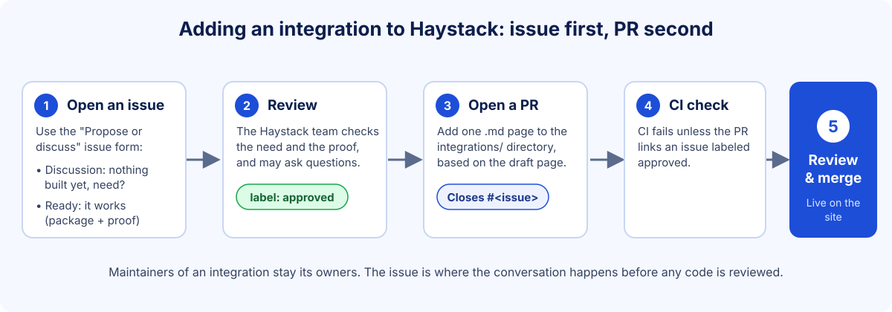

The [Haystack Integrations](https://haystack.deepset.ai/integrations) page is a community effort, and we want it to stay that way. But the way people create integrations has changed. Coding assistants can now produce an entire integration, from the package to the documentation page and the pull request, in a single session. That is great for contributors, yet it means our team receives far more pull requests than it can review carefully, and some of them describe integrations that were never tested in a real pipeline or that nobody asked for. Reviewing each of them takes real time away from the integrations people actually use. We are not alone in this, and a discussion on Lobsters inspired part of our approach.

Lobsters discussion · ask, culture

<a href="https://lobste.rs/s/ki1l5r/proof_use_as_requirement_for_open_source" style="color:#1d4ed8;text-decoration:none;">&ldquo;Proof of use&rdquo; as a requirement for open source contributions?</a>

A maintainer, overwhelmed by low-value LLM-generated pull requests, asks whether contributors should first prove they actually depend on the project, either through an open source project that imports it or a description of a production use. In their words: &ldquo;you need to show me that your project that depends on my project before I&rsquo;ll look at your PR.&rdquo;

Started by <a href="https://github.com/twpayne" style="color:#1d4ed8;">@twpayne</a> on November 16, 2026 &middot; <a href="https://lobste.rs/s/ki1l5r/proof_use_as_requirement_for_open_source" style="color:#1d4ed8;">Read the discussion on Lobsters &rarr;</a>

So we changed the rules in the [haystack-integrations repository](https://github.com/deepset-ai/haystack-integrations): **a new integration now starts with an issue, not a pull request.** You open an issue using the "Propose or discuss an integration" form, saying either that you want to discuss the need for an integration that doesn't exist yet, or that you already have one that works, with a link to the package and proof it is used in a real pipeline. A maintainer reviews it and, once it is ready, labels it `approved`. Only then do you open a pull request adding a single `.md` page to the `integrations/` directory, linking the issue with `Closes #<issue>`. An automated check fails any PR that does not link an approved issue.

Nothing about who can contribute has changed: the process is open to everyone, and you keep ownership of your integration. The issue simply gives us a place to agree on the need and the scope before anyone writes the code or the page. If you have built something for Haystack, [open an issue](https://github.com/deepset-ai/haystack-integrations/issues/new?template=new-integration.yml) and we will take a look. And if there is a tool you wish Haystack supported but nobody has built it yet, open the same issue and pick "Discussion". It is the best way to tell us, and the community, what is missing.
